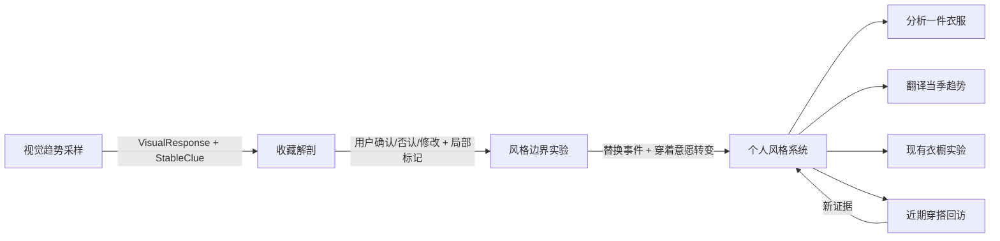

# 穿衣风格探索 V3：信息架构与交互状态

## 1. 产品原则

- 不把用户归类为法式、极简、老钱、知识分子等固定风格。
- 趋势母题仅作为采样素材；持久化数据只保存颜色、廓形、材质、比例、装饰、搭配关系、配饰与气质属性。
- 分开保存稳定审美、欣赏与理想偏好、现实穿着边界和当前探索兴趣。
- 所有判断必须能回到用户的图片、反应、局部标记、确认或修改记录。
- 冲突证据不会被强行平均；证据不足时显示“待探索”，不生成精确百分比。
- 四步完成后仍保留持续输入入口，让画像可以被真实穿着继续修正。

## 2. 页面路由

| 路由 | 页面职责 | 核心输出 |
| --- | --- | --- |
| `/explore` | 四步总览与进度恢复 | 当前会话状态 |
| `/explore/visual-sampling` | 8 个趋势母题、三种浓度、自适应采样 | `VisualResponse[]`、`StableClue[]` |
| `/explore/archive-decode` | 上传 5—12 张收藏、聚类、局部标记、用户复核 | `ArchiveImage[]`、`ArchiveObservation[]` |
| `/explore/style-lab` | 个性化方向、安全/延伸/实验区、元素替换 | `LabEditEvent[]`、`BoundaryTransition[]` |
| `/explore/style-system` | 四类个人画像、证据、趋势翻译与购物工具 | `StyleSystemOutput` |
| `/studio/analyze-item` | 持续入口：分析一件衣服 | 后续工具状态 |
| `/studio/translate-trend` | 持续入口：翻译趋势 | 后续工具状态 |
| `/studio/wardrobe-experiment` | 持续入口：现有衣橱实验 | 后续工具状态 |
| `/studio/outfit-check-in` | 持续入口：近期穿搭回访 | 后续修正证据 |

旧路由 `/explore/visual`、`/explore/upload`、`/explore/items`、`/explore/context`、`/explore/review` 会跳转到对应的新流程，避免旧链接失效。

## 3. 组件结构

```text
app/explore
├── page.tsx
├── visual-sampling/page.tsx
│   └── VisualSamplingExperience
├── archive-decode/page.tsx
│   └── ArchiveDecodeExperience
├── style-lab/page.tsx
│   └── StyleLabExperience
└── style-system/page.tsx
    └── StyleSystemExperience

components
├── JourneyProgress
├── JourneyOverview
└── exploration
    ├── visual-sampling-experience.tsx
    ├── archive-decode-experience.tsx
    ├── style-lab-experience.tsx
    └── style-system-experience.tsx

features
├── exploration/mock-engine.ts
└── session/session-storage.ts

data
└── style-exploration-mock.ts

types
└── style.ts
```

## 4. 状态流转



### STEP 01 自适应规则

1. 从母题的日常浓度开始。
2. “想穿 / 只欣赏 / 借一个元素”会提高相关属性和相邻浓度的采样优先级。
3. “无感 / 明确不喜欢”会降低同类题目优先级并扩大其他母题覆盖。
4. “借一个元素”只写入用户选中的局部，不把整套造型计为想穿。
5. 结束条件由稳定线索数量和母题覆盖共同决定，通常为 8—12 个样本，而不是固定题数。

### STEP 02 用户校正

1. 图片先按 Mock 属性生成初步聚类。
2. 每条观察必须为“确认 / 否认 / 修改”之一。
3. 否认的观察不会成为正向画像证据。
4. 图片意图分为真的想穿、只喜欢元素、只喜欢氛围、理想中的自己。
5. 用户可在图片上标记颜色、廓形、材质、层次、单品、配饰或气质局部。

### STEP 03 边界实验

1. 造型方向由前两步的证据 ID 生成，不使用固定 16 件公共单品。
2. 每个方向包含安全区、延伸区和实验区。
3. 场景作为造型条件存在，而不是独立的人格问卷。
4. 每次替换保存修改维度、修改前后值以及修改前后的穿着意愿。
5. 当用户先标记“不愿穿”，修改一个元素后再标记“愿意穿”，生成 `BoundaryTransition`。

### STEP 04 输出规则

1. `coreTaste`：跨来源反复出现且经过穿着证据支持的稳定审美。
2. `aspirationalTaste`：只欣赏、理想中的自己等证据形成的偏好。
3. `wearabilityBoundary`：不愿穿、明确不喜欢以及边界转变形成的现实条件。
4. `currentCuriosity`：近期出现但尚未稳定的趋势兴趣。
5. 每条 `TasteStatement` 保存自己的 `evidenceIds` 和离散置信状态。

## 5. 核心数据模型

```ts
type StyleSession = {
  version: 3;
  activeStep: "visual-sampling" | "archive-decode" | "style-lab" | "style-system";
  visualSampling: VisualSamplingState;
  archiveDecode: ArchiveDecodeState;
  styleLab: StyleLabState;
  styleSystem: { status: StepStatus; output: StyleSystemOutput | null };
  activity: { lastEntry?: ContinuousEntry; checkInCount: number };
};

type StyleSystemOutput = {
  coreTaste: TasteStatement[];
  aspirationalTaste: TasteStatement[];
  wearabilityBoundary: TasteStatement[];
  currentCuriosity: TasteStatement[];
  confidence: Record<string, ConfidenceLevel>;
  evidence: EvidenceRef[];
  trendTranslations: TrendTranslation[];
  shoppingFilters: ShoppingFilters;
  searchKeywords: string[];
  lowRiskExperiments: string[];
};

type ConfidenceLevel = "emerging" | "supported" | "stable" | "unresolved";
```

完整 TypeScript 定义位于 `src/types/style.ts`。

## 6. Mock 层边界

- `style-exploration-mock.ts`：8 个趋势母题、三种浓度、属性词表、示例收藏和造型方向。
- `mock-engine.ts`：自适应下一题、稳定线索、收藏聚类、证据汇总和个人系统生成。
- 当前推断是确定性的本地规则，便于验证交互和状态，不调用真实 AI。
- 未来接入 AI 时，UI 和会话模型不变，只替换 Mock engine 的实现，并继续要求结构化证据 ID。
